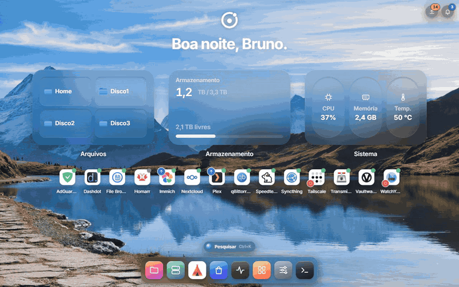
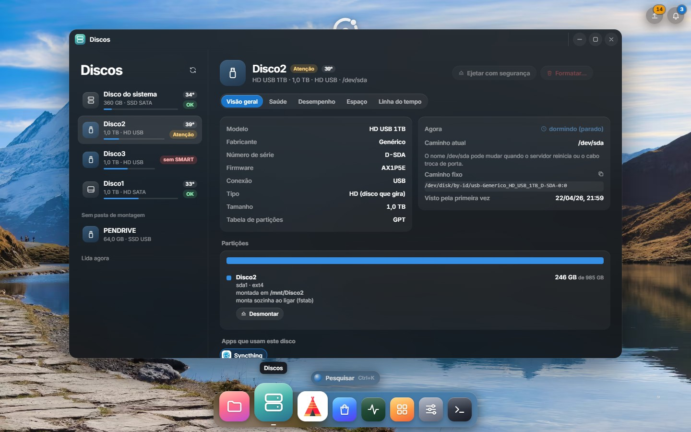
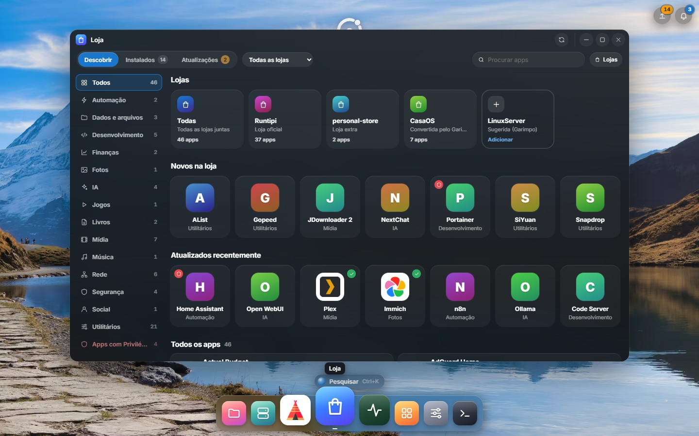
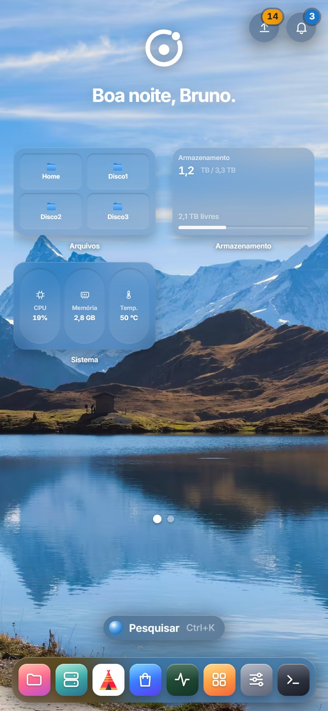
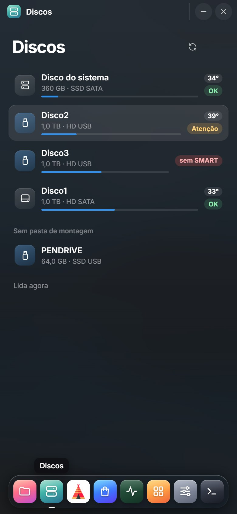

# BrunOS

**A beautiful, lightweight dashboard for your home server.** 
Your apps, files, disks and server usage in one place, in the style of UmbrelOS.

[🇧🇷 Português](README.md) · **🇺🇸 English**

 

### 👉 [Try it now, right in your browser](https://brunnofe.github.io/DashboardBrunOS/) 👈
Demo mode: fake data, any username and password work. The demo interface is in Brazilian Portuguese.

 

 

> **Note:** BrunOS's interface and most of its documentation are in Brazilian Portuguese. This page is a short overview for English readers.

## ✨ Why BrunOS?

If you run a home server you usually end up with dozens of apps, each on a different port. BrunOS puts them all on one beautiful, fast screen you can open from any device.

|   |   |
|---|---|
| 🪶 **Truly lightweight** | The image is about 4 MB and the dashboard uses around 10 MB of memory. It even fits old hardware. |
| 🎨 **Pretty and yours** | Glass effects, wallpapers, a dock that grows under your mouse, widgets and colors that match your wallpaper. |
| 🔌 **Ready for Runtipi** | It finds the apps you already installed, with name, icon and address. Nothing to configure. |
| 🔒 **Secure by default** | Runs without privileges, with your own username and password. Actions that touch the server ask for an extra password. |

## 🖼️ What it does

- **Home screen:** your apps as icons with a status dot, folders, and widgets for disk space, CPU, memory, temperature, internet, weather, clock, notes and to-dos. `Ctrl`+`K` searches apps, actions and files.
- **File manager:** browse, upload, download, edit text files, zip, trash and duplicate finder, with tabs.
- **Disk health:** temperature, space, performance and SMART status explained in plain words. The bell warns you *before* a disk fails.
- **Live usage:** CPU, memory, temperature and network charts, plus what each app consumes. Alerts when an app goes down or the internet drops.
- **App store:** browse Runtipi apps (and CasaOS / LinuxServer stores), install with a form and update everything without a terminal.
- **Also:** power usage and safe shutdown for laptop servers, a browser terminal, lock screen, and updates from the interface.

 

It also adapts to phones:

&nbsp;&nbsp;

## 🚀 Install in 3 steps

You need a server running [Runtipi](https://runtipi.io).

1. In Runtipi, add the app store: `https://github.com/BrunnoFe/RuntipiAppStore`
2. Install **BrunOS** and check the Runtipi folder in the form.
3. Open the app, create your user, done.

> The first user can only be created from inside your home network.

Full guide (in Portuguese): [docs/instalacao.md](docs/instalacao.md).

## 📚 Documentation (Portuguese)

| For | Where |
|---|---|
| Install, folders and variables | [docs/instalacao.md](docs/instalacao.md) |
| Every feature in detail | [docs/recursos.md](docs/recursos.md) |
| Hacking on the code, tests, API | [docs/desenvolvimento.md](docs/desenvolvimento.md) |
| How it works inside | [docs/projeto/arquitetura.md](docs/projeto/arquitetura.md) |
| Why each decision was made | [docs/projeto/decisoes.md](docs/projeto/decisoes.md) |

## 💙 Credits

Created by **Bruno Barbosa**, visually inspired by [UmbrelOS](https://github.com/getumbrel/umbrel). Icons from [dashboard-icons](https://github.com/homarr-labs/dashboard-icons), font Inter, text editor CodeMirror, terminal xterm.js. Full license list in [docs/desenvolvimento.md](docs/desenvolvimento.md#créditos-e-licenças-de-terceiros).

Code under the [MIT](LICENSE) license. Wallpapers come from UmbrelOS and are for personal use only.

 
Like it? Leave a ⭐ on the repo, it helps a lot!

