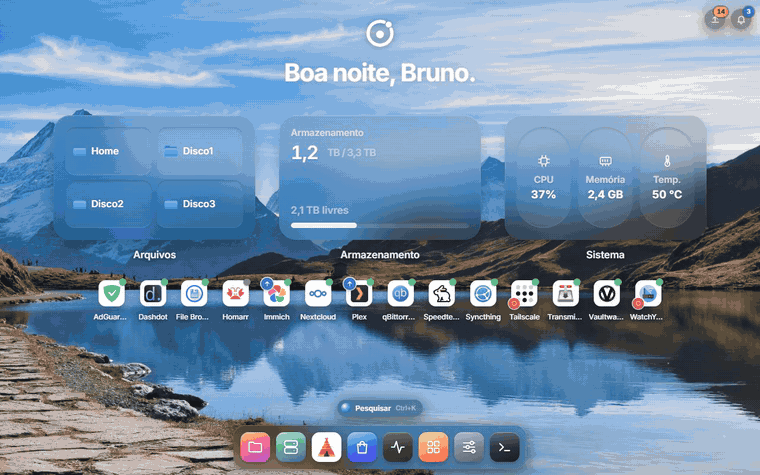
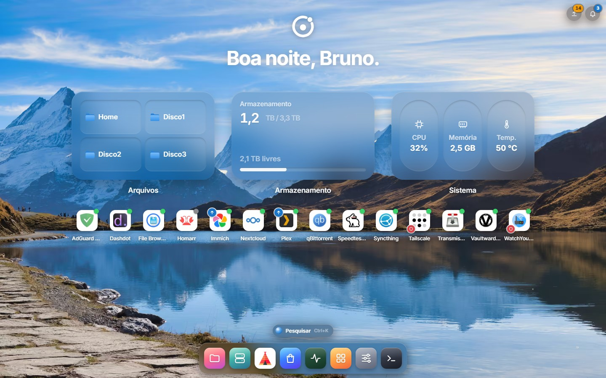
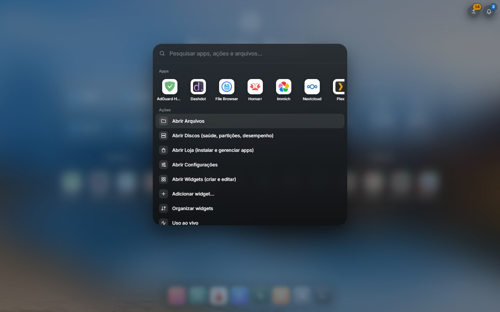
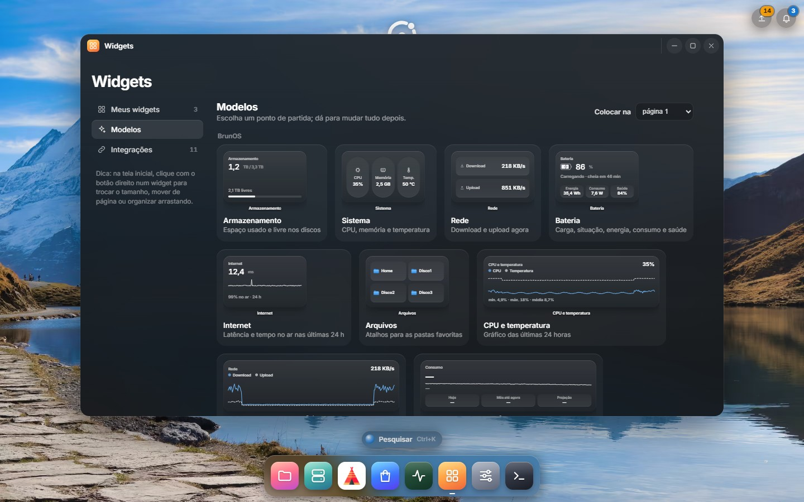
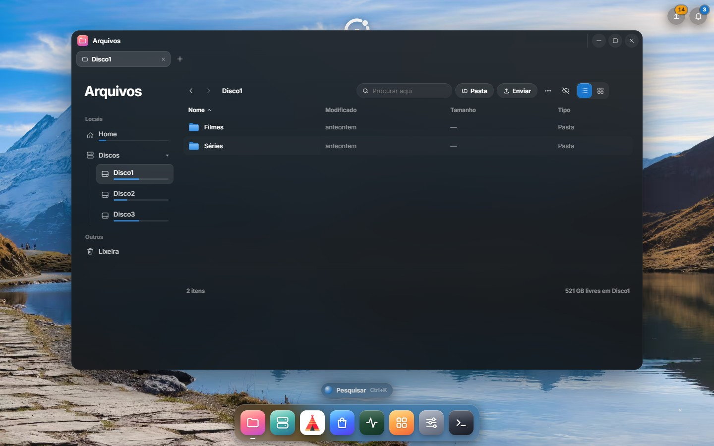
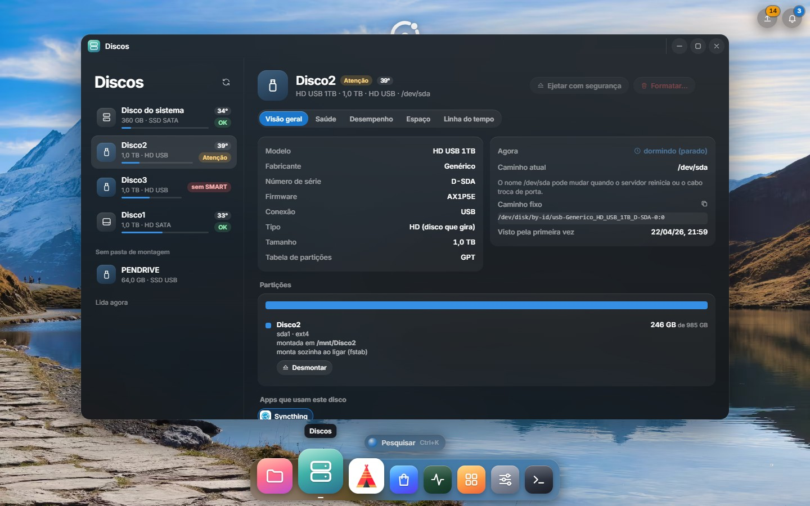
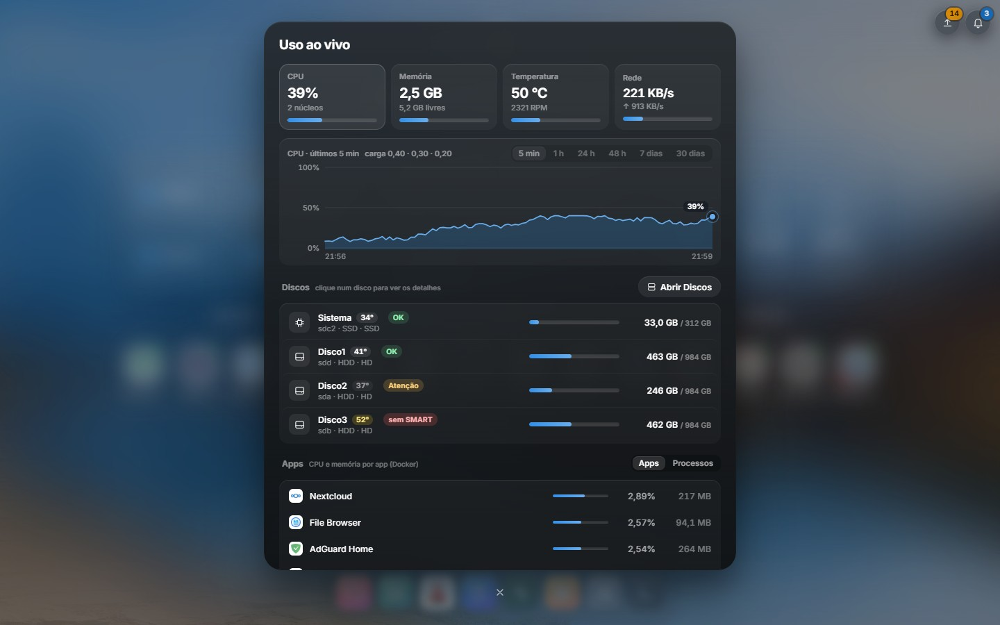
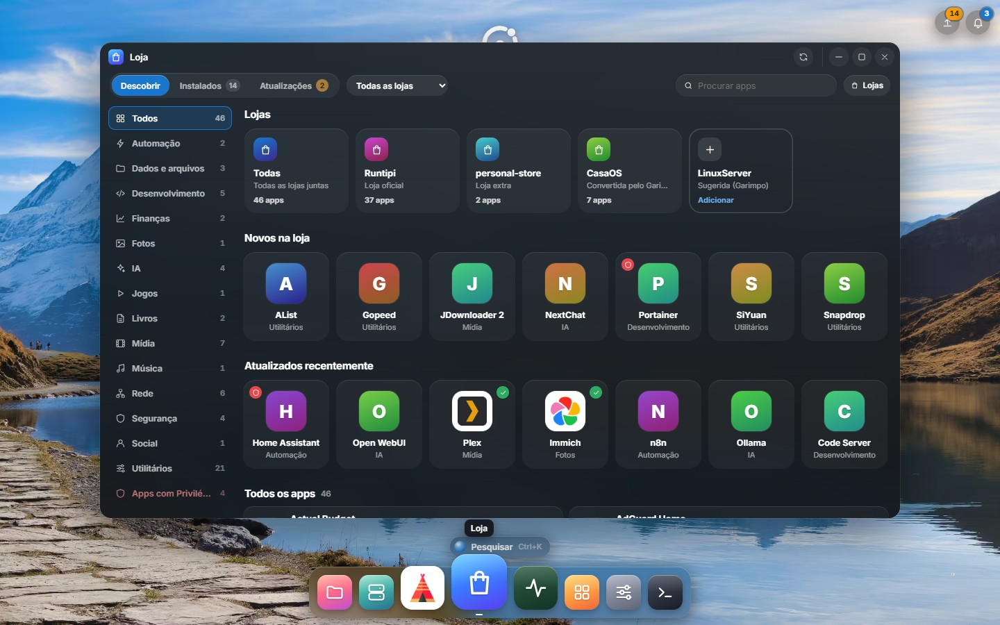
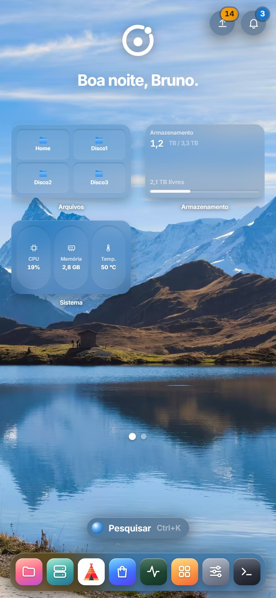
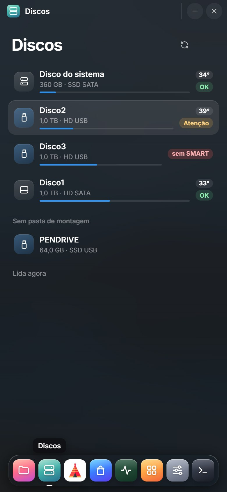

# BrunOS

**O painel bonito e leve para o seu servidor caseiro.** 
Seus apps, arquivos, discos e o uso do servidor num só lugar, no estilo do UmbrelOS.

**🇧🇷 Português** · [🇺🇸 English](README.en.md)

 

### 👉 [Experimente agora, direto no navegador](https://brunnofe.github.io/DashboardBrunOS/) 👈
Modo demonstração: dados de mentira, qualquer usuário e senha entram.

 

[Conhecer](#conhecer) ·
[Instalar](#instalar) ·
[Perguntas](#perguntas) ·
[Documentação](#documentacao)

 

 

## ✨ Por que o BrunOS?

Quem tem um servidor em casa costuma acabar com dezenas de apps, cada um numa porta diferente. O BrunOS junta tudo numa tela só, bonita e rápida, que você abre de qualquer aparelho.

|   |   |
|---|---|
| 🪶 **Leve de verdade** | A imagem tem cerca de 4 MB e o painel usa por volta de 10 MB de memória. Cabe até em servidor velho. |
| 🎨 **Bonito e do seu jeito** | Vidro, papel de parede, dock que cresce quando o mouse passa, widgets e cores que combinam com a imagem. |
| 🔌 **Pronto para o Runtipi** | Ele encontra os apps que você já instalou, com nome, ícone e endereço. Nada para cadastrar. |
| 🔒 **Seguro por padrão** | Roda sem privilégios, com usuário e senha seus. As ações que mexem no servidor pedem uma senha extra. |
| 🇧🇷 **Em português** | Interface e mensagens de erro em português do Brasil. |

 

## 🖼️ O que ele faz

### Tudo à mão na tela inicial

Seus apps aparecem como ícones, com uma bolinha mostrando se estão no ar. Arraste um sobre o outro para criar pastas. Os **widgets** mostram o que importa: espaço nos discos, CPU, memória, temperatura, internet, clima, relógio, notas e lista de tarefas. Aperte <kbd>Ctrl</kbd>+<kbd>K</kbd> para buscar qualquer app, ação ou arquivo.

 

 

### Arquivos do servidor no navegador

Navegue, envie, baixe, edite textos, compacte, apague (com lixeira) e encontre arquivos duplicados. Funciona com várias abas, como num computador de verdade.

 

### Saúde dos discos, sem susto

Veja cada disco com temperatura, espaço, desempenho e o estado de saúde explicado em português simples. O sino avisa **antes** de um disco dar problema, quando um disco novo é conectado ou quando um some.

 

### Uso do servidor ao vivo

Gráficos de CPU, memória, temperatura e rede, e quanto cada app está consumindo. Avisa no sino quando um app cai ou quando a internet some.

 

### Loja para instalar e atualizar apps

Navegue pelos apps do Runtipi (e de outras lojas, como CasaOS e LinuxServer), instale com um formulário e atualize tudo sem abrir o terminal.

 

### Também no celular

A interface se adapta a telas pequenas: o mesmo painel, com a dock embaixo, na palma da mão.

&nbsp;&nbsp;

 

### E mais

<b>🔔 Avisos no sino</b>

 

Queda de energia, disco quente ou cheio, app que parou, internet que caiu e acesso de um aparelho novo ao painel.

<b>⚡ Energia e desligamento seguro</b>

 

Acompanhe quanto o servidor gasta (em watts e em reais, com projeção do mês). Em notebooks usados como servidor, o BrunOS pode desligar tudo com segurança quando a bateria estiver acabando.

<b>💻 Terminal no navegador</b>

 

Um terminal do servidor com abas, direto no painel, sem precisar de outro programa.

<b>🔒 Tela de bloqueio</b>

 

Um relógio grande sobre o papel de parede, com senha para voltar e bloqueio automático depois de um tempo parado.

<b>⬆️ Atualizações pela interface</b>

 

Um botão mostra quantas atualizações existem (apps e Linux). Dá para atualizar com um clique e acompanhar o andamento.

Todos os detalhes, um por um, estão em **[docs/recursos.md](docs/recursos.md)**.

 

## 🚀 Instalar em 3 passos

Você precisa de um servidor com o [Runtipi](https://runtipi.io) funcionando.

1. No Runtipi, adicione a loja de apps: `https://github.com/BrunnoFe/RuntipiAppStore`
2. Instale o **BrunOS** e confira no formulário a pasta do Runtipi.
3. Abra o app, crie seu usuário e pronto.

> O primeiro usuário só pode ser criado de dentro da rede de casa.

Quer testar antes, sem instalar nada? Abra a **[demonstração no navegador](https://brunnofe.github.io/DashboardBrunOS/)**, com dados de mentira.

Passo a passo completo, pastas e opções: **[docs/instalacao.md](docs/instalacao.md)**.

 

## ❓ Perguntas rápidas

<b>Preciso saber programar?</b>

 

Não. Instalar e usar é tudo pela interface.

<b>Funciona sem o Runtipi?</b>

 

Ele foi feito para o Runtipi e é lá que mostra tudo o que sabe fazer. Em outros cenários, o uso fica limitado.

<b>Meus dados ficam seguros?</b>

 

Tudo fica no seu servidor, nada vai para a nuvem. O único contato com a internet é a previsão do tempo, e só se você criar um widget de clima. O painel roda sem privilégios, e ações delicadas (formatar disco, desinstalar app) pedem uma segunda senha.

<b>Qual a diferença para o Homarr, Dashy e outros?</b>

 

O BrunOS não é só um painel de atalhos: ele também gerencia arquivos, discos, apps e energia, continuando muito leve e com a cara do umbrelOS.

<b>Posso usar no celular?</b>

 

Sim, a interface se adapta a telas pequenas.

 

## 📚 Documentação

| Para quê | Onde |
|---|---|
| Instalar, pastas e variáveis | [docs/instalacao.md](docs/instalacao.md) |
| Cada recurso em detalhe | [docs/recursos.md](docs/recursos.md) |
| Mexer no código, rodar testes, API | [docs/desenvolvimento.md](docs/desenvolvimento.md) |
| Como o BrunOS funciona por dentro | [docs/projeto/arquitetura.md](docs/projeto/arquitetura.md) |
| Por que cada decisão foi tomada | [docs/projeto/decisoes.md](docs/projeto/decisoes.md) |
| Histórico de versões | [docs/projeto/historico.md](docs/projeto/historico.md) |
| O que vem por aí | [docs/projeto/roadmap.md](docs/projeto/roadmap.md) |

 

## 💙 Créditos

Criado por **Bruno Barbosa**, com inspiração visual no [umbrelOS](https://github.com/getumbrel/umbrel). Os ícones vêm do [dashboard-icons](https://github.com/homarr-labs/dashboard-icons), a fonte é a Inter, o editor de texto é o CodeMirror e o terminal usa o xterm.js. A lista completa de licenças está em [docs/desenvolvimento.md](docs/desenvolvimento.md#créditos-e-licenças-de-terceiros).

Código sob licença [MIT](LICENSE). Os papéis de parede são do umbrelOS e valem só para uso pessoal.

 
Gostou? Deixe uma ⭐ no repositório, ajuda muito!

